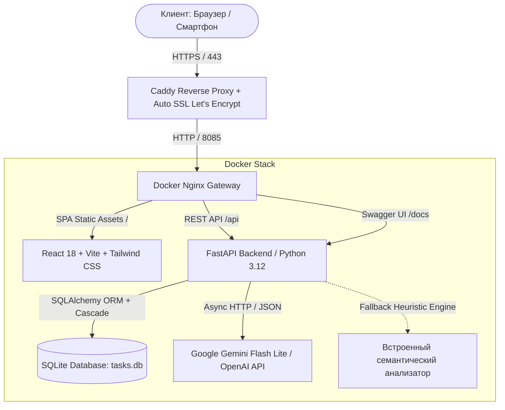
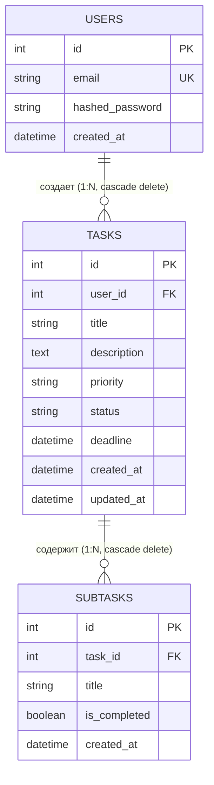

# 🚀 Mini Task Tracker with AI

[](https://task-tracker-ai.arazteam.online)
[](https://task-tracker-ai.arazteam.online)
[](https://task-tracker-ai.arazteam.online/docs)
[](https://python.org)
[](https://fastapi.tiangolo.com)
[](https://react.dev)
[](https://www.typescriptlang.org)
[](https://tailwindcss.com)
[](https://www.docker.com)

> **Mini Task Tracker with AI** — высокопроизводительное веб-приложение для управления задачами в эстетике Linear и Vercel с глубокой интеграцией AI (декомпозиция задач на подзадачи с интерактивным чеклистом, автогенерация детальных описаний и расчет дедлайнов с анализом сложности).

🌐 **Живое демо:** [https://task-tracker-ai.arazteam.online](https://task-tracker-ai.arazteam.online)  
📖 **Swagger API документация:** [https://task-tracker-ai.arazteam.online/docs](https://task-tracker-ai.arazteam.online/docs)

---

## 📸 Скриншоты интерфейса

| Канбан-доска (Linear Dark Style) | AI Декомпозиция и Чеклист |
|---|---|
|  |  |

---

## 🌟 Ключевые возможности

### 1. 🤖 Полноценный AI-ассистент задач (Google Gemini & OpenAI)
- **Декомпозиция на подзадачи:** автоматическое разбиение задачи на 3–6 практических шагов с созданием интерактивного чеклиста как при создании, так и при редактировании.
- **Интеллектуальная генерация описания:** составление структурированного Markdown-описания с целями, требованиями и критериями готовности (Definition of Done).
- **Предиктивный расчет дедлайна:** оценка сложности задачи и приоритета с обоснованием рекомендуемого срока.
- **Интеллектуальная приоритизация (AI Prioritization):** автоматическое определение и обоснование критичности задачи (`urgent`, `high`, `medium`, `low`).
- **Мгновенный отклик и отказоустойчивость (Graceful Fallback):** молниеносный отклик без подвисаний как с внешними API, так и со встроенным семантическим движком.

### 2. 📋 Управление задачами (Task Management)
- Полный жизненный цикл задачи: `To Do` → `In Progress` → `Done`.
- 4 уровня приоритетов: `Urgent` (🔥), `High` (⚡), `Medium`, `Low`.
- Нативный **Drag & Drop** карточек между колонками Канбан-доски.
- Интерактивный чеклист подзадач с процентным индикатором выполнения и анимацией прогресс-бара.
- Праздничный салют (Confetti) при 100% выполнении подзадач или завершении задачи.
- Быстрое перемещение между колонками и редактирование любого поля (включая очистку дедлайна и описания).

### 3. 🔍 Фильтрация и поиск в реальном времени (Бонус +3 балла)
- Мгновенный поиск по подстроке в названии и описании задач.
- Фильтры по статусу (`Все`, `To Do`, `В работе`, `Готово`).
- Фильтры по приоритету (`Все`, `Срочный`, `Высокий`, `Средний`, `Низкий`).
- Переключение режимов отображения: **Канбан-доска** или **Табличный список (List View)**.

### 4. 📱 Адаптивный мобильный интерфейс (Бонус +2 балла)
- Полноценная мобильная версия с адаптивными табами колонок, поддержкой тач-интерфейса и компактной навигацией.

### 5. 🔐 Безопасность и архитектура
- Аутентификация на основе **JWT** (JSON Web Tokens) с защищенным хешированием паролей **bcrypt** (12 раундов соли).
- Изоляция данных: каждый пользователь видит исключительно свои задачи.
- Реляционная база данных **SQLite** с контролем целостности (`PRAGMA foreign_keys = ON`) и каскадным удалением связей (`User 1:N Task 1:N Subtask`).
- RESTful API со строгой типизацией Pydantic v2 и корректными HTTP-кодами (`200`, `201`, `204`, `400`, `401`, `404`).

---

## 🏛 Схема архитектуры (Mermaid)



---

## 🗄 Модель данных (ER-диаграмма)



---

## 🛠 Стек технологий

| Уровень | Технологии |
|---|---|
| **Frontend** | React 18, TypeScript, Vite, Tailwind CSS, Lucide Icons, Sonner Toasts, Canvas Confetti |
| **Backend** | Python 3.12, FastAPI, SQLAlchemy 2.0, Pydantic v2, PyJWT, Bcrypt, HTTPX, Pytest |
| **Database** | SQLite3 с включенными foreign keys и каскадным удалением |
| **AI Integration** | Google Gemini 3.5 Flash Lite, OpenAI API compatible protocol + Fallback Heuristics |
| **DevOps & Infra** | Docker, Docker Compose, Nginx, Caddy 2 (Let's Encrypt TLS), Ubuntu 24.04 LTS |

---

## 🚀 Быстрый запуск

### Способ 1: Через Docker Compose (рекомендуется)

```bash
# 1. Клонировать репозиторий
git clone https://github.com/KARAPUZ1226/task-tracker-ai.git
cd task-tracker-ai

# 2. Скопировать переменные окружения
cp backend/app/config.py backend/.env # или создать .env

# 3. Собрать и запустить все контейнеры
docker compose up -d --build

# Приложение будет доступно по адресу: http://localhost:8085
# Документация API: http://localhost:8085/docs
```

### Способ 2: Локальный запуск для разработки

#### 1. Запуск Backend (FastAPI):
```bash
cd backend
python3 -m venv venv
source venv/bin/activate
pip install -r requirements.txt

# Запуск тестов
pytest -v tests

# Запуск сервера разработки
uvicorn app.main:app --reload --port 8000
```

#### 2. Запуск Frontend (Vite):
```bash
cd frontend
npm install
npm run dev
# Открыть http://localhost:3000
```

---

## 🧪 Запуск тестов

Проект покрыт автоматическими тестами (модульные, интеграционные, проверка каскадного удаления и изоляции пользователей):

```bash
cd backend
source venv/bin/activate
pytest -v tests
```

Результат выполнения тестов:
```
tests/test_api.py::test_health_check PASSED                              [ 20%]
tests/test_api.py::test_auth_flow PASSED                                 [ 40%]
tests/test_api.py::test_task_crud_and_cascade PASSED                     [ 60%]
tests/test_api.py::test_filters_and_search PASSED                        [ 80%]
tests/test_api.py::test_ai_endpoints PASSED                              [100%]
======================== 5 passed in 2.17s =========================
```

---

## 📡 API Эндпоинты

| Метод | Путь | Описание |
|---|---|---|
| `POST` | `/api/auth/register` | Регистрация нового пользователя |
| `POST` | `/api/auth/login` | Вход и получение JWT токена |
| `GET` | `/api/auth/me` | Данные текущего пользователя |
| `GET` | `/api/tasks` | Список задач (фильтры `search`, `status`, `priority`) |
| `POST` | `/api/tasks` | Создание новой задачи (с опциональными подзадачами) |
| `GET` | `/api/tasks/{id}` | Получение задачи по ID |
| `PATCH` | `/api/tasks/{id}` | Обновление полей задачи (статус, дедлайн, приоритет) |
| `DELETE` | `/api/tasks/{id}` | Удаление задачи (каскадно удаляет подзадачи) |
| `POST` | `/api/tasks/{id}/subtasks` | Добавление подзадачи |
| `PATCH` | `/api/tasks/{id}/subtasks/{subtask_id}` | Обновление статуса/названия подзадачи |
| `DELETE` | `/api/tasks/{id}/subtasks/{subtask_id}` | Удаление подзадачи |
| `POST` | `/api/ai/decompose` | AI декомпозиция на подзадачи |
| `POST` | `/api/ai/generate-description` | AI генерация структурированного описания |
| `POST` | `/api/ai/suggest-deadline` | AI расчет срока и оценка сложности |
| `GET` | `/docs` | Интерактивный Swagger UI |

---

## 👨‍💻 Автор

- **GitHub:** [@KARAPUZ1226](https://github.com/KARAPUZ1226)
- **Проект:** Mini Task Tracker with AI (Хакатон отборочный этап)
- **Лицензия:** MIT